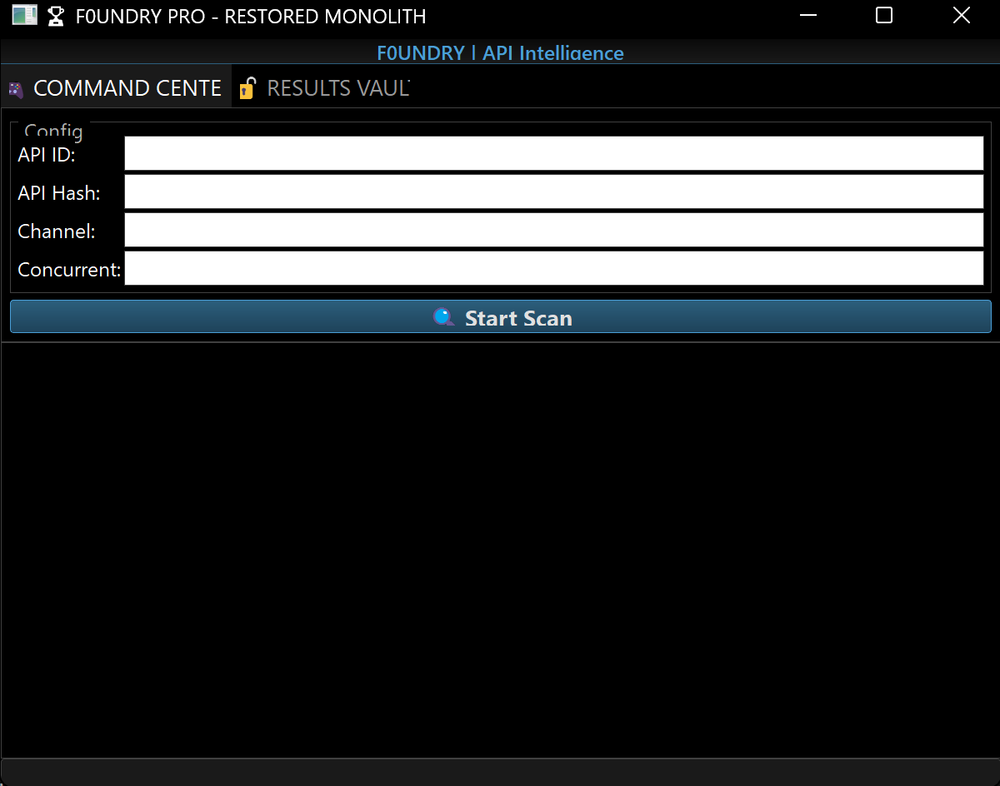

# 🔥 F0undry — Telegram Domain & Secret Exposure Monitor 🔐

F0undry is a proactive security reconnaissance tool built to detect fresh domains, redirect chains, and leaked secrets spreading through Telegram channels and communities. 🚨

The idea is simple: when new domains are created and shared quickly, they often go live before they are properly audited. Many of them may expose misconfigured pages, hidden tokens, redirect-based abuse, or sensitive credentials that are left behind in plain sight. F0undry helps identify these risks early. 🛡️

It connects to Telegram through the Telethon API, scans historical messages from a selected channel or chat, extracts links and short URLs, resolves them through a browser automation flow, and then checks the final destination domains for exposed secrets. 🔍

Once the target domain is identified, F0undry runs detection checks using browser automation and tools such as TruffleHog and other secret discovery workflows to flag anything sensitive. 📡

The final results are presented in a GUI for quick review and triage. 🧭



## 🚀 What F0undry does

F0undry is designed to solve a very specific and important problem:

- Telegram communities share new domains and shortened links very quickly ⚡
- These domains are often created in haste and may be poorly monitored 🏗️
- Redirects and landing pages can expose hidden secrets or credentials 🔓
- Security teams need a fast way to spot suspicious domains before they become a bigger issue 🧑‍💻

In practice, the tool performs the following steps:

1. Connects to Telegram using the Telethon API 📲
2. Retrieves historical messages from a target channel or chat 🗂️
3. Extracts URLs, short links, and redirect payloads 🔗
4. Opens them through a browser with Playwright or Selenium 🌐
5. Resolves the final destination domain and landing page 🧩
6. Scans the page and related assets for exposed secrets 🔐
7. Runs secret discovery checks using TruffleHog and similar workflows 🛰️
8. Lists the findings in a GUI for easier analysis 📊

## 🧠 Why it matters

Freshly launched domains are often the perfect place for:
- leaked credentials
- exposed API keys
- hidden tokens
- fake or malicious landing pages
- redirect abuse
- misconfigured developer assets

F0undry gives defenders and security researchers a way to automate early detection and reduce the window of exposure. ✅

This is especially useful for:
- Security researchers 👨‍🔬
- Bug bounty workflows 🐞
- Threat intelligence teams 🛰️
- Defensive monitoring of Telegram communities 📣
- Early detection of exposed credentials and infrastructure risks 🚨

## ✨ Core Features

### Telegram-based reconnaissance
- Extracts URLs and links from target Telegram channels or chats 💬
- Scans historical messages for short links and new domains 🧾
- Normalizes suspicious target data for follow-up analysis 🎯

### Browser-based URL resolution
- Opens links in a headless browser using Playwright / Selenium 🌐
- Resolves redirect chains to the real destination domain 🔄
- Captures final pages and extracted content 📸

### Secret detection
- Scans discovered pages and assets for sensitive information 🔍
- Uses secret-finding patterns and validation workflows 🧪
- Integrates with TruffleHog and similar detection tools 🛡️

### GUI reporting
- Displays results in a clean, analyst-friendly interface 🖥️
- Helps prioritize high-risk findings faster 🚀
- Makes monitoring repetitive targets much easier 📋

## 📁 Project Structure

```text
F0undry/
├── core/
│   ├── f0undry_gui.py
│   └── frank_headless_v2_ultimate.py
├── tools/
│   ├── SecretFinder-master/
│   ├── keyhacks-master/
│   ├── HEDnsExtractor-main/
│   ├── t-hoog-ex/
│   └── keyhacks_validator.py
├── config/
│   └── config.py
├── chrome-win/
│   └── chrome.exe
├── results/
├── run_f0undry.py
├── README.md
├── requirements.txt
└── f0undry-screenshot.png
```

## ⚙️ Installation

### Prerequisites
```bash
python -m venv .venv
source .venv/bin/activate
pip install -r requirements.txt
```

### Optional browser setup
```bash
playwright install chromium
```

## 🚀 Quick Start

```bash
git clone https://github.com/ksbicorp/F0undry.git
cd F0undry
python -m venv .venv
source .venv/bin/activate
pip install -r requirements.txt
playwright install chromium
python run_f0undry.py
```

## 🔐 Configuration

Set your Telegram credentials before running the tool:

```bash
export TELEGRAM_API_ID="your_api_id"
export TELEGRAM_API_HASH="your_api_hash"
```

You may also need to update values inside `config/config.py` depending on your environment and use case. 🧩

## ⚠️ Legal & Ethical Use

F0undry is intended for authorized security testing and defensive research only.

- ✅ Use only on systems or domains you own or are explicitly authorized to test
- ✅ Use for defensive monitoring and research
- ❌ Do not scan unauthorized infrastructure
- ❌ Do not use it for malicious purposes
- ❌ Do not violate platform terms or applicable laws

## 🧾 Disclaimer

This project is a research and monitoring tool focused on early detection of exposed data and suspicious infrastructure. It is not intended to facilitate unauthorized access, abuse, or malicious activity. 🚫

## 🤝 Credits

This project builds on tools and ideas from the broader security research ecosystem, including:

- SecretFinder 🔍
- TruffleHog 🦡
- KeyHacks ✅
- HEDnsExtractor 🌐
- Playwright 🎭
- Telethon 📡

## 📣 Contributing

Contributions are welcome. If you want to improve detection logic, add new URL workflows, enhance the browser automation, or improve the GUI experience, feel free to open an issue or submit a pull request. 💡

---

⭐ Star this repo if you find it useful!  
🐛 Report bugs  
💡 Suggest improvements  
📢 Share it with the community
